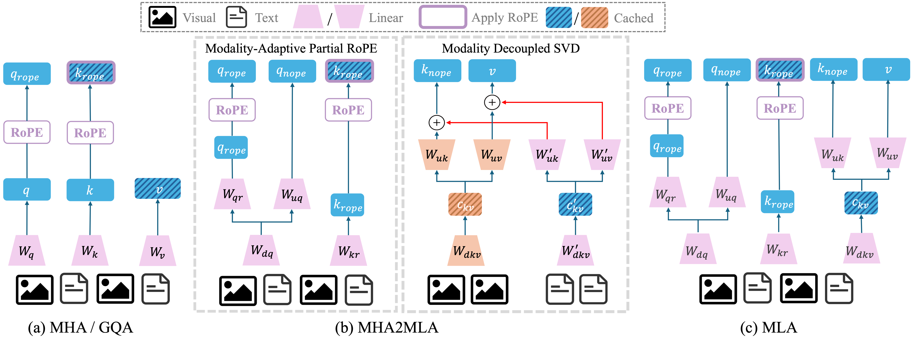

# MHA2MLA-VLM — AAAI 2026

[← MLAfication projects](../README.md)

Run commands from `MHA2MLA-VLM/`. Activate this project's Python environment first. The launchers resolve this directory automatically, including when invoked from another directory.


Code for **MHA2MLA-VLM: Enabling DeepSeek's Economical Multi-Head Latent Attention Across Vision-Language Models**, published at **AAAI 2026**. [Proceedings](https://ojs.aaai.org/index.php/AAAI/article/view/40319) · [arXiv](https://arxiv.org/abs/2601.11464).



Our code supports three representative VLMs:
- LLaVA-1.5: llava-hf/llava-1.5-7b-hf
- LLaVA-NeXT: llava-hf/llama3-llava-next-8b-hf
- Qwen2.5-VL: Qwen/Qwen2.5-VL-7B-Instruct


## News

- [2026.01.22] The three [MLA checkpoints](https://huggingface.co/cnxup/models) ($d_{kv}$=32/64/128) derived from `Qwen2.5-VL-7B` are publicly available.
- [2026.01.17] Released the MHA2MLA-VLM code, providing usage code for VLMs fine-tuning and evaluations.


## Datasets

We use different datasets for different models:

| Model | Dataset |
|-------|---------|
| LLaVA-1.5 | [LLaVA-Instruct](https://huggingface.co/datasets/liuhaotian/LLaVA-Instruct-150K/tree/main) |
| LLaVA-NeXT | [LLaVA-NeXT-Data](https://huggingface.co/datasets/lmms-lab/LLaVA-NeXT-Data) |
| Qwen2.5-VL | [LLaVA-NeXT-Data](https://huggingface.co/datasets/lmms-lab/LLaVA-NeXT-Data) |


## Environment

Install pytorch and other packages.

```sh
conda create -n mha2mla-vlm python=3.11
conda activate mha2mla-vlm
pip install torch==2.4.0 torchvision==0.19.0
pip install -r requirements.txt
```

## Training

Select one model implementation: `llava`, `llavanext`, or `qwen2_5_vl`.
For example:

```bash
MODEL_IMPL=qwen2_5_vl
```

Prepare the dataset JSON files and images, then edit the selected model's
`src/mha2mla-vlm/<model>/cfgs/stage1.yaml` and `stage2.yaml`. Set the base model,
data paths, output/checkpoint paths, `low_rank`, and SVD tensor path to match
your run. Paths such as `data/`, `mkl/`, and `qwen2_5_vl/checkpoints/` are
relative to this project directory.

### 1. Stage-1 partial-RoPE training

```bash
bash "src/mha2mla-vlm/${MODEL_IMPL}/scripts/stage1.sh"
```

The launcher uses one process by default. Set `NPROC_PER_NODE` and
`CUDA_VISIBLE_DEVICES` for your hardware; `CFG_FILE` overrides the YAML path.

### 2. Modality-decoupled SVD initialization

Edit `BASE_MODEL`, `STAGE1_CKPT_PATH`, `DATASET_PATH`, `LOW_RANK`, and
`OUTPUT_PATH` in the selected initializer script. Match its output tensor to
`svd_init_weight_path` and `low_rank` in the stage-2 YAML.

```bash
bash "src/mha2mla-vlm/${MODEL_IMPL}/scripts/run_svd_init.sh"
```

The initializer calls `run_svd_init.py --stage1_path ...`, matching the
Python entry point. The stage-1 checkpoint must exist before this step.

### 3. Stage-2 training

```bash
bash "src/mha2mla-vlm/${MODEL_IMPL}/scripts/stage2.sh"
```

## Evaluation

Evaluation uses the bundled, modified [lmms-eval](lmms-eval/) implementation.
The launchers put it and the selected model adapter on `PYTHONPATH`, preserving
the MLA modifications in `llava_hf.py` and `qwen2_5_vl.py`.

```bash
# MODEL_PATH overrides the default stage-2 checkpoint; evaluation defaults to 8 processes.
MODEL_PATH=/path/to/stage2_ckpt NPROC_PER_NODE=4 \
  bash "eval/${MODEL_IMPL}/eval.sh"
```

For the quantized KV-cache evaluation provided for LLaVA-NeXT:

```bash
MODEL_PATH=/path/to/llavanext/stage2_ckpt NPROC_PER_NODE=4 \
  bash eval/llavanext/eval_quant.sh
```

The published environment and experiment configurations are retained. This
repository reorganization has been checked statically; it does not constitute
a new GPU reproduction of the paper's results.

## Citation

```bibtex
@inproceedings{fan2026mha2mlavlm,
  title = {MHA2MLA-VLM: Enabling DeepSeek's Economical Multi-Head Latent Attention Across Vision-Language Models},
  author = {Fan, Xiaoran and Sun, Zhichao and Ji, Tao and Shen, Lixing and Gui, Tao},
  booktitle = {Proceedings of the AAAI Conference on Artificial Intelligence},
  volume = {40},
  number = {36},
  pages = {30638--30646},
  year = {2026},
  doi = {10.1609/aaai.v40i36.40319},
  url = {https://ojs.aaai.org/index.php/AAAI/article/view/40319}
}
```
