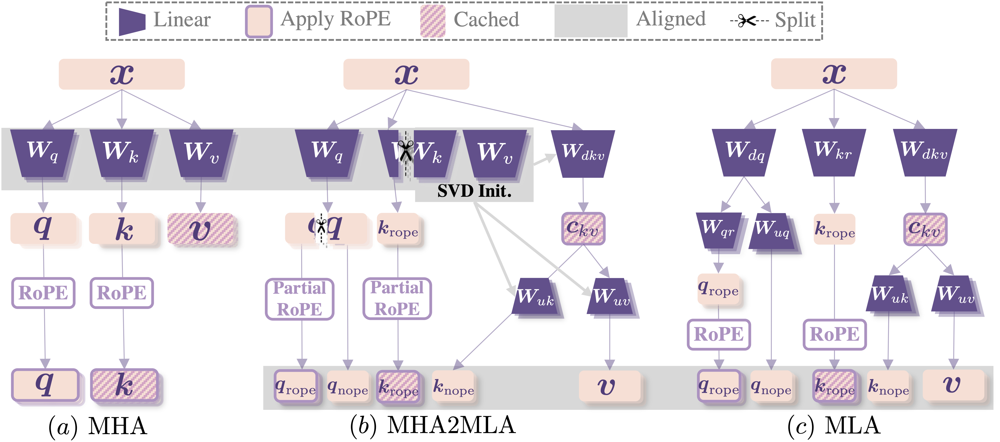

# MHA2MLA — ACL 2025

[← MLAfication projects](../README.md)

Run the commands below from `MHA2MLA/`. The configuration files retain the original experiment settings; update model, dataset, checkpoint, and output paths for your machine before running. This project has its own `requirements.txt`.

This repo contains the code for the paper ["Towards Economical Inference: Enabling DeepSeek's Multi-Head Latent Attention in Any Transformer-based LLMs"](https://arxiv.org/abs/2502.14837).

**Published at ACL 2025:** [proceedings](https://aclanthology.org/2025.acl-long.1597/).



## News

- [2025.06.13] Release the refactored code and add support for the Qwen model.
- [2025.03.12] Released the inference code implemented using **PyTorch** (support for [FlashMLA](https://github.com/deepseek-ai/FlashMLA) inference requires additional development time).
- [2025.03.04] The four [MLA checkpoints](https://huggingface.co/collections/fnlp/mha2mla-67c51287dfc6cd46127e1b92) ($d_{kv}$=8/16/32/128) derived from `SmolLM-135M/360M/1B7` are publicly available.
- [2025.03.03] The four [MLA checkpoints](https://huggingface.co/collections/fnlp/mha2mla-67c51287dfc6cd46127e1b92) ($d_{kv}$=16/32/64/256) derived from `Llama-2-7B` are publicly available.
- [2025.02.21] The paper of MHA2MLA is publicly available: https://arxiv.org/abs/2502.14837
- [2025.02.19] Released the first version of the MHA2MLA code, providing usage code for Llama fine-tuning and evaluating.

## TO-DO

- [x] Provide the code for incorporating the projection matrix and inference.
- [ ] Thanks to DeepSeek for open-sourcing the [FlashMLA](https://github.com/deepseek-ai/FlashMLA) inference framework. It’s theoretically possible to save more GPU memory usage using this framework. Let’s see how economical MHA2MLA + FlashMLA (+ KV quanto) can be!
- [x] Release the code of MHA2MLA based on HuggingFace `Transformers`

## Datasets

First download the datasets.

- smollm-corpus(fineweb-edu-dedup, cosmopedia-v2, python-edu): https://huggingface.co/datasets/HuggingFaceTB/smollm-corpus
- open-web-math: https://huggingface.co/datasets/open-web-math/open-web-math
- stackoverflow: https://huggingface.co/datasets/bigcode/stackoverflow-clean

Secondly, process the datasets according to https://github.com/huggingface/nanotron/blob/main/docs/nanoset.md.

## Environment

Install pytorch and other packages.

```sh
conda create -n mha2mla python=3.11
conda activate mha2mla
pip install torch==2.4.0 torchvision==0.19.0
pip install -r requirements.txt
```

## Fine-Tuning

First, prepare configuration files referencing [SmolLM1-135M-4GPU.yml](./cfgs/SmolLM1-135M-4GPU.yml).

For information on the configuration of mha2mla, you can refer to the [arguments.py](./src/mha2mla/arguments.py) file.

Then, use the following command for fine-tuning:

```sh
torchrun --nproc_per_node 4 \
    ./src/mha2mla/run_train.py \
    --cfg_file ./cfgs/SmolLM1-135M-4GPU.yml
```

> If you want to use the partial-RoPE version `2-norm`, you should get the `qk_tensor` first.
> Using the following command, you can get the `qk_tensor`:
>
> ```sh
> torchrun --nproc_per_node 1 \
>     ./src/mha2mla/2_norm.py \
>     --config_file ./cfgs/2-norm-cfgs/2-norm-SmolLM1-135M.yml
> ```

## Lighteval Evaluation

For evaluation, you can use the following command:

```sh
accelerate launch --multi_gpu --num_processes=4 \
    ./eval/eval.py \
    accelerate \
    --model_args "pretrained=${model_name_or_path},revision=main,dtype=bfloat16,max_length=2048" \
    --override_batch_size 48 \
    --custom_tasks "./eval/tasks.py" \
    --tasks "./eval/smollm1_base.txt" \
    --output_dir "./eval_results/"
```

## LongBench Evaluation

For the baseline evaluation, you can use the following command:

```sh
torchrun --nproc_per_node=4 \
    ./eval/longbench.py \
    --model_path ${model_name_or_path} \
    --tokenizer_path ${model_name_or_path} \
    --longbench True \
    --lb_max_tokens 2048 \
    --lb_batch_size 16 \
    --output_dir ./longbench/bf16 \
    --dtype "bfloat16"
```

If you want to use the quantized KV cache, you can use the following command:

```sh
torchrun --nproc_per_node=4 \
    ./eval/longbench.py \
    --model_path ${model_name_or_path} \
    --tokenizer_path ${model_name_or_path} \
    --longbench True \
    --lb_max_tokens 2048 \
    --lb_batch_size 16 \
    --output_dir ./longbench/${model_name_or_path}_hqq_int4 \
    --dtype "bfloat16" \
    --cache_implementation "quantized" \
    --backend "HQQ" \
    --nbits 4 \
    --residual_length 128
```

## Citation

```bibtex
@inproceedings{ji-etal-2025-towards,
  title = {Towards Economical Inference: Enabling DeepSeek's Multi-Head Latent Attention in Any Transformer-based LLMs},
  author = {Ji, Tao and Guo, Bin and Wu, Yuanbin and Guo, Qipeng and Shen, Lixing and Chen, Zhan and Qiu, Xipeng and Zhang, Qi and Gui, Tao},
  booktitle = {Proceedings of the 63rd Annual Meeting of the Association for Computational Linguistics (Volume 1: Long Papers)},
  year = {2025},
  pages = {33313--33328},
  publisher = {Association for Computational Linguistics},
  doi = {10.18653/v1/2025.acl-long.1597},
  url = {https://aclanthology.org/2025.acl-long.1597/}
}
```
